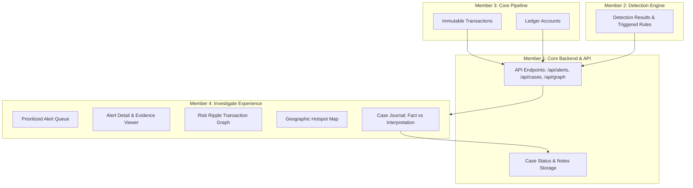

# TRACE Investigate Architecture | Member 4

## Overview
**TRACE** (**Transaction Risk Analysis, Connectivity & Evidence**) is an enterprise transaction risk analysis platform. Member 4 is responsible for the analyst-facing **Investigate** module, consisting of:
1. **Prioritized Alert Queue & Dashboard**
2. **Risk Ripple Directed Transaction Graph**
3. **Geographic Hotspot Map**
4. **Case Management, Notes & Status Lifecycle**

This module is designed strictly as a modular plugin to the shared TRACE application shell. It does not spin up a competing router, redundant backend, or separate detection engine.

---

## Architectural Principles & Compliance

### 1. Investigation Priorities, Not Proof of Wrongdoing
- **Risk Scores**: Risk scores (0–100) indicate the urgency with which an analyst should prioritize an alert. They are investigative leads, not legal proof of fraud or illicit activity.
- **Graph Connections**: Counterparty edges represent actual funds transferred between accounts on record. Relationships are never fabricated or embellished. Connected accounts are leads for inquiry.

### 2. Separation of Observed Facts vs. Analyst Interpretation
- **Evidence Items (`EvidenceItem`)**: Strictly captures immutable observed telemetry (ledger records, velocity metrics, sovereign jurisdictions traversed).
- **Investigation Notes (`InvestigationNote`)**: Typed distinctly as `ANALYST_INTERPRETATION` (hypotheses), `PROCEDURAL_UPDATE` (administrative state changes), or `SUPERVISORY_REVIEW` (approvals). Analyst conjecture is never presented as established fact.

### 3. Absolute Transaction Immutability
- Updating a case's status (e.g. from `NEW` to `UNDER_REVIEW` or `CLOSED_RESOLVED`) or adding investigation notes modifies only the investigation case record.
- Core transaction records (`Transaction`) and accounts (`Account`) are strictly immutable and read-only.

### 4. Ethical Geographic Mapping
- Only valid Earth coordinates (latitude -90 to +90, longitude -180 to +180) or clearly labelled synthetic demonstration coordinates (`[SYNTHETIC DEMO DATA]`) are plotted.
- The interface explicitly distinguishes **Count** (transaction volume) from **Rate** (flagged transaction velocity ratio).
- Locations are never guessed or inferred from phone numbers, BINs, or account numbers.
- If verified location telemetry is absent, an informative empty state is rendered rather than fabricating hotspots.

---

## Component Architecture

- `InvestigateModule`: Mountable module entry point adhering to Member 1's contracts.
- `InvestigationStore`: Centralized reactive state store managing filter states, selected cases, graph nodes, and map metrics.
- `ITraceInvestigateApi`: Contract for the backend API client.
  - `HttpTraceInvestigateClient`: Live REST client consuming Member 1 endpoints.
  - `InMemoryTraceApiAdapter`: Isolated adapter populated with synthetic demonstration data for offline testing and development.
- `RiskRippleGraphModel`: Computes Cytoscape-compatible node and directed edge elements from actual transactions with temporal sequence ordering.
- `GeoAggregator`: Validates coordinates and aggregates transactions into regional clusters with explicit Count vs. Rate calculations.
- `InvestigateUiRenderer`: High-contrast, responsive UI renderer with clear loading, empty, and error states.
